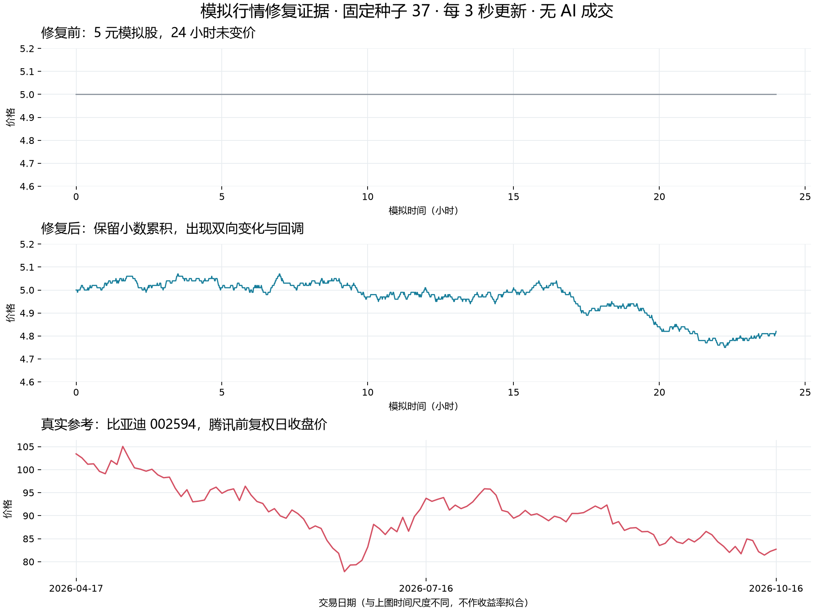

# 1.1.0 交付与验收

日期：2026-10-16。包名 `com.mengxinggg.gupiaomoniqi`，Android versionCode 8。源码、服务端与 Web 同版本。

## 本轮实现

- Android 白色三点 AI 球：40 dp 外观、48 dp 触摸区、拖动吸边、轻动画；球体只打开对话/会话，AI 管理在主设置。
- 持久会话、模型列表与兼容测试、只读行情/选股工具、逐项数据授权、3000 字符记忆文件、固定 AGENT.md、用户可选 32K–1M 上下文与自动思考。
- Android/Web K 线白底、细网格与均线；Android 支持缩放、历史翻页、十字光标、全屏、副图，压缩报价区高度并保留大字布局。
- Web 无 AI 助手，有 App 下载弹窗、版本说明与 SHA-256；重画 Android 自适应图标。
- 按股票补缺：保留主源成功标的，缺失股票整份报价交给腾讯，仍缺失的 A 股再交给新浪；A 股日/月 K 和盘口可单股补取。来源入库且在详情展示。
- 修复 Python 回退缺失入口、Linux 解释器选择边界与取消/重试预算。
- 修复模拟价格取整冻结、行业因子重复更新和规则 AI 的成交量/退出/仓位行为。

## 算法证据

固定随机种子 37、初始价 1/5/20/100、每 3 秒更新、连续 24 小时；关闭 AI 成交与自动事件，单独观察价格引擎。下表为每条路径的 `(最高价-最低价)/初始价`，不是投资收益。

| 初始价 | 修复前振幅 | 修复后振幅 | 修复后最大回撤 |
|---|---:|---:|---:|
| 1 | 0% | 8% | 约 7.77% |
| 5 | 0% | 6.4% | 约 6.31% |
| 20 | 2.5% | 4% | 约 3.91% |
| 100 | 4.09% | 6.44% | 约 6.29% |

修复前 1 元和 5 元标的全天没有一次变价；内部保留小数后可跨越最小报价单位。低价股仍可能因一分钱最小刻度保持一段时间不变，不能承诺每次 tick 都变价。同种子用于可复现，不意味着两版本抽样序列完全相同。

真实参考为腾讯返回的比亚迪 002594 前复权日 K，2026-04-17 至 2026-10-16 共 121 条，最后一条当天尚未收盘。真实日线与上方模拟 24 小时采用不同时间尺度，只展示真实涨跌和回调形态，不据此声称统计拟合完成。

另用 40 只股票、70 名规则 AI、60 秒加速时钟跑 14 天，经过真实交易服务与账本，累计 51,463 笔成交。第 12/13/14 天累计成交为 40,762 / 45,764 / 51,463；后期持续有买卖，收盘价不变的股票数为 2/1/2。检查正价格与每日边界。该测试是加速集成回放，不是生产运行 14 天验收。

## 构建与运行验收

- TypeScript 与 Web 生产构建通过。
- 合并远端行情时效修复后，服务端 37 个测试文件、187 项测试全部通过（含 17 项临时助手、行情缺陷与智能补缺验证）；清理临时验证后保留 170 项项目测试。最终部署目录修正后的相关 33 项复测通过。
- Android debug/release 构建和 75 项 JVM 单元测试通过。
- 模拟器验证白球拖动位置保存、主设置管理入口、会话持久化、任务收起后继续、返回已完成回复；K 线 60→40 根缩放、历史日期切换、点选 OHLC 和全屏均正常。
- 使用隔离账户、内存数据库与模拟兼容模型测试 AI。没有连接用户真实模型账户或让助手执行交易。
- 按股票补缺测试记录：只缺比亚迪时网络请求仅含比亚迪；新浪只接收腾讯未补齐的 A 股；取消不再发起网络；非法价格/标的/时间被拒绝；成功主源报价受到保护；来源可从数据库重载；更换本股 K 线区间不改动其他股票。
- 真实网络适配器在约 10:45 取得比亚迪报价、161 根日 K、60 根月 K 和盘口。随后在模拟器用录制的真实数据注入主源失败，确认 Android 可解析腾讯历史枚举、显示“报价补缺：腾讯”和来源行情时间。
- Web 下载按钮、弹窗版本/大小/校验值和实际 APK HTTP 下载通过，下载字节的 SHA-256 与构建 APK 一致。
- 编译后的服务端可加载 shared 包、固定 AGENT.md 并初始化助手存储；Windows 发布脚本语法检查通过。发布包补齐固定规则与 shared/dist，开发/测试入口会先构建 shared。
- 模拟器已覆盖安装最终 release APK，恢复正式服务器配置，移除本轮测试端口转发。
- 已删除本轮临时测试脚本、隔离账户/模型数据、下载副本、项目 node_modules、编译 dist、Android 构建目录与项目 Gradle 缓存；保留桌面 APK、正式源码和本验收文档中的算法对比图。未删除真实数据库、用户配置及全局工具链。

## APK

桌面文件名：`四海模拟盘-1.1.0.apk`，大小 7,075,406 字节。

SHA-256：`34db9d36cfef668300b730bb3198148a6f869dab2cdac906e3a59cb728ba276e`。

继续使用既有安装包证书保持覆盖安装兼容；证书 SHA-256：`db62654d1f0f55e0c78914849522bba8d056c7501d210bd51c0e6ff99ad67b32`。该项目既有 release 配置采用历史 debug 证书，本轮没有擅自换签名。

## 部署与边界

本轮交付源码和桌面 APK，不代表生产 Linux 服务已部署。AI API、模拟市场算法、数据补缺和 Web 更新需要部署本次服务端；线上 App 下载还需使用 `scripts/publish-android-update.mjs` 发布到服务器更新目录。生产目录、真实账户、配置及全局 Android/JDK 工具链不属于清理对象。

首次部署会迁移真实行情库至 schema 5（新增报价来源字段），保留原账户、持仓与行情。助手目录优先使用 `ASSISTANT_DATA_DIR`，其次使用 `DATABASE_DIR` 同级的 `assistant`，未配置时为 `server/data/assistant`；须持久化并保留 master.key。Linux 服务配置为 `/var/lib/gupiaomoniqi/assistant`，Windows 发布启动器使用持久数据目录下的 `assistant`，避免随源码发布目录更换而丢失数据。当前文件存储面向单进程。

尚未覆盖：真实付费模型端到端、生产 Linux 网络恢复、英股备用源、港美股的同口径历史备用、分时/年 K 备用、未知股票清单发现、五日/周 K 与复权切换。联网搜索在本机被保留地址校验拦截，未宣称真实搜索链路验收通过。没有自动语义摘要；上下文超限时明确裁剪旧消息，历史仍保留。

运行策略与实际支持矩阵详见 [行情数据多路线评估](行情数据多路线评估.md) 与 [AI 助手实现](AI助手-记忆上下文与对话交互.md)。
